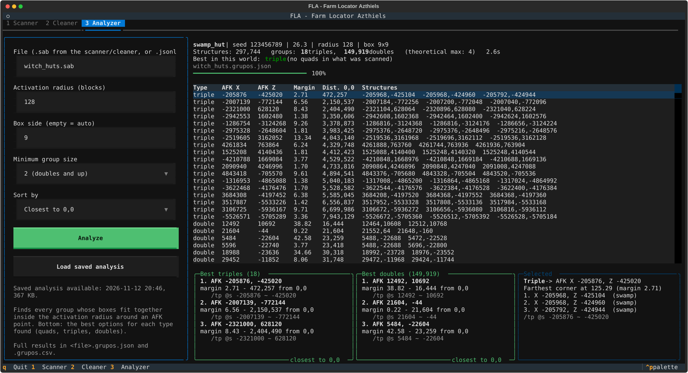

# FLA - Farm Locator Azthiels

**Find the best spots in a Minecraft seed for multi-structure farms.**
FLA scans a whole world (up to the 30-million-block border) for a structure type, finds every place where two,
three or four of them can be active at the same time from one AFK spot, and tells you exactly where to stand.

Built for technical survival players: quad/triple Witch Hut farms, multi-monument guardian farms, outpost farms and so on.



*[Leer en español](README.es.md)*

## Features
- **Full-world scans in minutes.** A whole 26.3 world for Witch Huts takes about **6 minutes** on an 8-thread CPU
  (around 40 million regions per second), using [Cubiomes](https://github.com/Cubitect/cubiomes) in C.
- **Exact results.** It reproduces the game's own structure placement and biome rules. The speed-ups (skipping
  structures that cannot be part of a group, and a climate prefilter for 1.18+) are exact, and the test suite checks
  that they give the same result as the slow path.
- **Groups and AFK points.** Doubles, triples, quads...: every group whose spawning boxes fit inside the 128-block
  activation radius around the player, the best block to stand on, how much margin you have, and a `/tp` command.
- **Versions 1.7 to 26.3**, Overworld, Nether and End, 20 structure types.
- **Pause and resume.** Long scans save checkpoints; stop at any time and continue later without losing work.
- **Auto mode.** Scan, clean and analyze in one go, with a desktop notification when it is done.
- **English and Spanish** interface.

## Quick start
You need **Python 3.10+** (tested with 3.14). Tested on Windows and Linux; macOS should work but is untested.

```bash
git clone https://github.com/Azthiels/FLA---Minecraft.git
cd FLA---Minecraft
pip install -r requirements.txt
python main.py
```

The first launch compiles the native library (`lib/`). If you have `gcc`, `clang` or `cc` it uses that; otherwise it
installs `ziglang` through pip and compiles with it automatically. This takes about 2 minutes, only once.

Then: type your seed, pick the version and the structure, tick **Auto mode** and press **Start**.
When it finishes, tab **3 Analyzer** shows the best groups. See the **[step-by-step guide](docs/GUIDE.md)** for
everything else.

Straight from the command line:

```bash
python main.py --seed 123456789 --version 26.3 --structure 3 --output witch_huts --auto --start
```

## How it works (short version)
1. **Scanner.** Minecraft places at most one structure attempt per region (512x512 blocks for Witch Huts). The
   position of each attempt is cheap math; checking the biome is the expensive part. In *groupable only* mode FLA
   first looks at the positions and only checks the biome of structures that have a neighbour close enough to form a
   group. On 1.18+ it also checks one or two climate values before computing the full biome, using an exact bound on
   the game's nearest-neighbour biome lookup. Most positions are discarded after a couple of noise samples.
2. **Cleaner.** For full scans: removes every structure with no possible partner.
3. **Analyzer.** Builds the graph of compatible pairs, finds the maximal groups, checks each one with the smallest
   circle that contains all the spawning boxes, and picks the best block for the AFK spot.

Technical details (in Spanish): [README.es.md](README.es.md).

## Accuracy notes
- Spawning boxes are modelled as squares big enough for any rotation (Witch Hut 7x9 -> 9x9), so FLA never recommends
  a group that does not fit. The radius is measured horizontally: if your AFK spot is much higher or lower than the
  spawning floors, lower the radius.
- Desert Pyramid, Jungle Temple and Woodland Mansion on 1.18+ depend on a terrain heuristic from Cubiomes.
- Nether Fossils are not supported (Cubiomes cannot check their terrain).

## Development
```bash
python -m tests              # full test suite (about 1-2 minutes)
python bench/bench.py rapido # quick benchmark
```

## License
MIT (see [LICENSE](LICENSE)). Includes Cubiomes (MIT, Cubitect) and its loot library (MIT, ScriptLine).
Not affiliated with Mojang or Microsoft.
