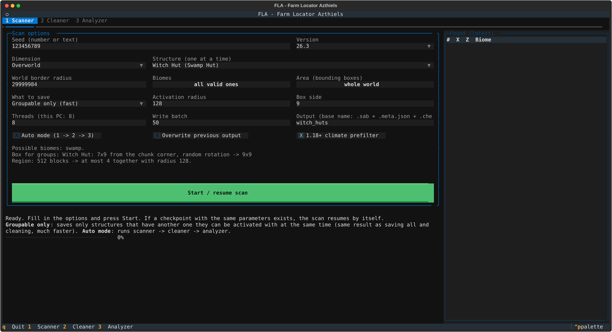
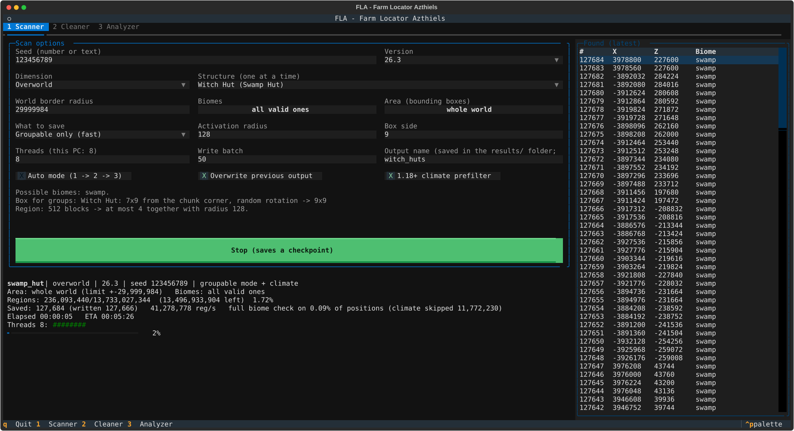
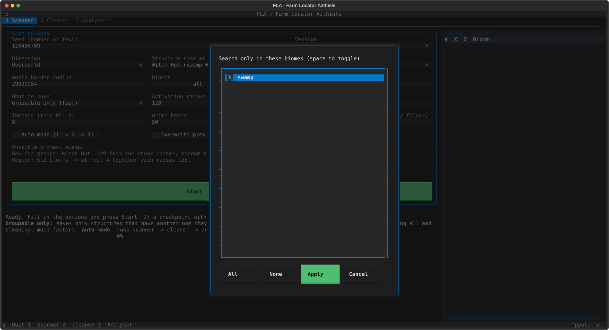
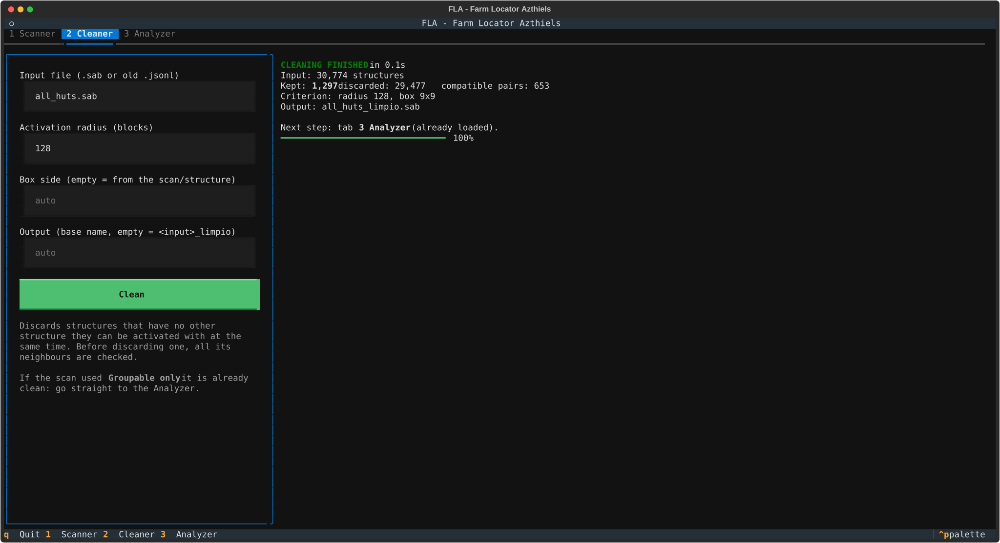
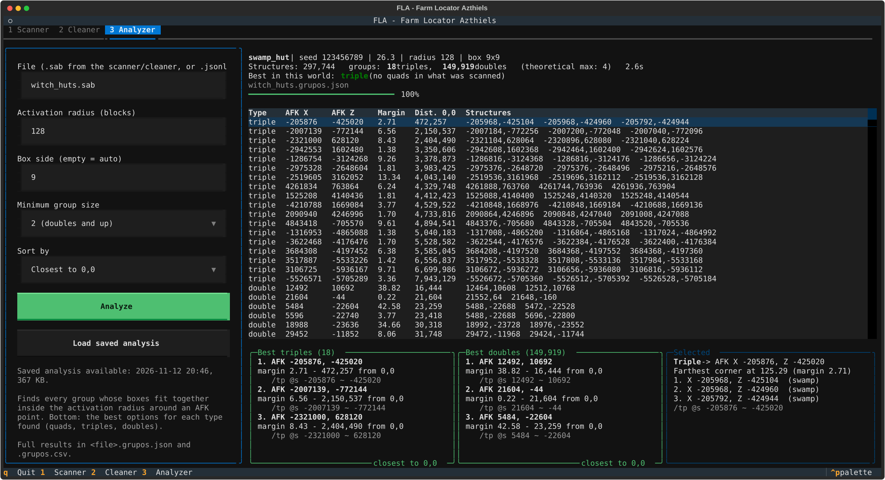
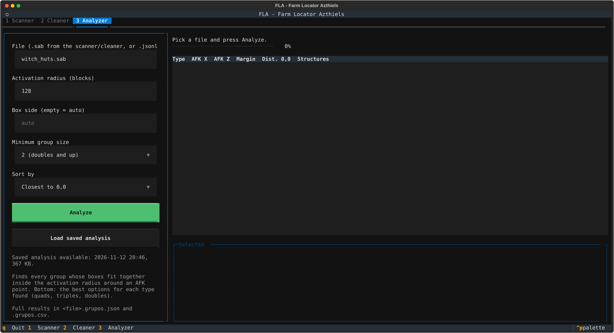

# FLA step-by-step guide

This guide walks you through finding a farm location from scratch: scanning a seed, reading the results and
standing in the right spot in game.

Contents
1. [Install](#1-install)
2. [Launch](#2-launch)
3. [Scan a seed (tab 1)](#3-scan-a-seed-tab-1)
4. [Clean a full scan (tab 2)](#4-clean-a-full-scan-tab-2)
5. [Read the results (tab 3)](#5-read-the-results-tab-3)
6. [Build the farm](#6-build-the-farm)
7. [Command line](#7-command-line)
8. [Files FLA creates](#8-files-fla-creates)
9. [FAQ and troubleshooting](#9-faq-and-troubleshooting)

---

## 1. Install
1. Install **Python 3.10 or newer** from [python.org](https://www.python.org/downloads/) (on Windows, tick
   *"Add Python to PATH"*).
2. Download FLA, either with git or with *Code -> Download ZIP* on GitHub:
   ```bash
   git clone https://github.com/Azthiels/FLA---Minecraft.git
   cd FLA---Minecraft
   ```
3. Install the two dependencies (Textual for the interface, NumPy for the analysis):
   ```bash
   pip install -r requirements.txt
   ```

The first time you run FLA it compiles its native library. If you have a C compiler (`gcc`, `clang`, `cc`) it uses
it; if not, it installs `ziglang` with pip and uses that. It takes about two minutes and only happens once.

## 2. Launch
```bash
python main.py
```
Use a terminal at least **160 columns wide** (maximized is best). The interface is in English by default; for
Spanish use `python main.py --lang es`, or create a `config.json` file next to `main.py` with `{"IDIOMA": "es"}`.

Keys: **1 / 2 / 3** switch tabs, **q** quits (a running scan is saved first), the mouse works everywhere.

## 3. Scan a seed (tab 1)



Fill in the options box:

| Option | What it means |
|---|---|
| **Seed** | Your world seed, as a number or as text (text seeds are hashed like the game does). |
| **Version** | The exact Minecraft version of your world. Results change between versions. |
| **Dimension / Structure** | One structure type per scan. The list only shows what exists in that version and dimension. |
| **World border radius** | How far from 0,0 to scan. The default is the vanilla border (29,999,984): the whole world. |
| **Biomes** | Optionally restrict to some of the biomes the structure can spawn in. This is an *extra* filter, never a replacement for the game rules. |
| **Area (bounding boxes)** | Optionally scan only some rectangles instead of the whole world. |
| **What to save** | **Groupable only (fast)** keeps only structures that have a partner close enough to form a farm: same result as saving everything and cleaning, but much faster. **All structures** keeps the full list. |
| **Activation radius** | 128 blocks: mobs only spawn within 128 blocks of a player. |
| **Box side** | Size of the structure's spawning box, filled in automatically (9 for Witch Huts). Approximate for some structures: a note below tells you. |
| **Threads** | CPU threads to use. Defaults to all of them. |
| **Output name** | Base name of the result files, saved in the **`results/` folder** next to `main.py`. It is filled in for you from the structure, seed and version (for example `swamp_hut_123456789_26.3`), so scans of different seeds never overwrite each other. Type your own name if you prefer; FLA will not change it. |
| **Auto mode** | When the scan finishes, clean (if needed) and analyze automatically. Recommended. |
| **Overwrite previous output** | Start from zero even if there is a previous scan with that name. |
| **1.18+ climate prefilter** | Exact speed-up for 1.18 and newer. Leave it on. |

Press **Start**. The status area shows the progress, speed, time left and how many structures were saved so far;
the right column lists the latest ones found.



**Stopping and resuming.** Press **Stop** (or **q**) at any time: FLA saves a checkpoint. Run the same scan again
(same seed, version, structure and options, same output name) and it continues where it stopped. If any option is
different it refuses to mix the results and tells you which one changed.

### Restricting biomes or area
**Biomes** opens a list with only the biomes where that structure can generate:



**Area** lets you add rectangles (X1, Z1, X2, Z2). Overlapping rectangles are fine: each region is scanned once.

## 4. Clean a full scan (tab 2)
Only needed if you scanned with **All structures**. The cleaner removes every structure that has no partner close
enough to ever be part of a group. Before removing one it checks all its neighbours, in any direction.



With **Auto mode** you never need to touch this tab. In *Groupable only* mode the scan is already clean.

## 5. Read the results (tab 3)



- **Summary (top):** how many groups of each size there are, the theoretical maximum for that structure (4 for
  Witch Huts, because there is at most one per 512x512 region), and the best size this world has.
- **Table:** every group, biggest first, then sorted by distance to 0,0 or by margin (**Sort by**).
- **Best boxes (bottom):** one box per group size found (quads, triples, doubles) with its three best options and
  a ready-to-use `/tp`. The **Selected** box shows the row highlighted in the table, with the coordinates of each
  structure.

What the numbers mean:
- **AFK X, Z:** the block to stand on.
- **Margin:** how many blocks of slack you have. With a margin of 5, every spawning box is at least 5 blocks inside
  the 128-block radius. Small margins (below 1) work only if you stand exactly on that block.
- **Dist. 0,0:** how far the spot is from the world origin.

**Loading a previous analysis.** Every analysis is saved in `results/` next to its scan (`<name>.grupos.json`, a
few hundred KB). Press **Load saved analysis...**: the file explorer opens in the `results/` folder; pick a
`.grupos.json` (or the `.sab` of a scan) and it is loaded at once, in about a second, without recalculating. If you
pick a scan that has not been analyzed yet, it is placed in the **File** box so you only have to press **Analyze**.
If the data changed after the saved analysis, FLA tells you.



## 6. Build the farm
1. Copy the `/tp` command of the group you chose and go there (creative or spectator is easiest for planning).
2. The AFK block is the centre of the farm: every spawning box is within 128 blocks of it, measured horizontally.
3. Keep your AFK height close to the spawning floors. The 128-block limit is a sphere: if you stand far above or
   below the structures, the horizontal reach shrinks. As a rule of thumb, groups with more margin tolerate more
   height difference.
4. Mobs also need you to be **more than 24 blocks** away to spawn, so nothing spawns right around your AFK spot.

## 7. Command line
Every option of the scanner can be given on the command line; the interface opens with the form filled in.

```bash
python main.py --seed 123456789 --version 26.3 --structure 3 --output witch_huts --auto --start
```

| Option | Meaning |
|---|---|
| `--lang en\|es` | interface language |
| `--seed`, `--version` | seed and Minecraft version |
| `--structure ID` | structure id (table below) |
| `--border BLOCKS` | world border radius |
| `--mode groups\|all` | groupable only (default) or all structures |
| `--radius BLOCKS`, `--side BLOCKS` | activation radius, structure box side |
| `--threads N`, `--batch N` | CPU threads, write batch |
| `--output NAME` | base name of the result files |
| `--no-climate`, `--overwrite` | disable the 1.18+ prefilter, start from zero |
| `--auto`, `--start` | auto mode, start the scan right away |

There is also a console-only analyzer: `python -m sa.analizador witch_huts.sab`.

Structure ids:

| id | Structure | Dimension |
|---|---|---|
| 1 | Desert Pyramid | Overworld |
| 2 | Jungle Temple | Overworld |
| 3 | Witch Hut (Swamp Hut) | Overworld |
| 4 | Igloo | Overworld |
| 5 | Village | Overworld |
| 6 | Ocean Ruin | Overworld |
| 7 | Shipwreck | Overworld |
| 8 | Ocean Monument | Overworld |
| 9 | Woodland Mansion | Overworld |
| 10 | Pillager Outpost | Overworld |
| 11 | Ruined Portal | Overworld |
| 12 | Ruined Portal | Nether |
| 13 | Ancient City | Overworld |
| 14 | Buried Treasure | Overworld |
| 18 | Nether Fortress | Nether |
| 19 | Bastion Remnant | Nether |
| 21 | End City | End |
| 24 | Trail Ruins | Overworld |
| 25 | Trial Chambers | Overworld |
| 26 | Abandoned Camp | Overworld |

## 8. Files FLA creates
Everything goes to the `results/` folder next to `main.py` (an absolute output path is used as is). In the File boxes
you can type just the name (`witch_huts.sab`) or `results/witch_huts.sab`. For an output name `witch_huts`:

| File | Content |
|---|---|
| `witch_huts.sab` | the structures found (compact binary: 12 bytes each) |
| `witch_huts.meta.json` | seed, version, options, counts, status of the scan |
| `witch_huts.checkpoint.json` | progress, used to resume |
| `witch_huts_limpio.*` | cleaned version (only for *All structures* scans) |
| `witch_huts.grupos.json` | analysis summary and the top 2,000 groups (what *Load saved analysis* opens) |
| `witch_huts.grupos.csv` | **every** group, for spreadsheets (can be large: ~170 MB for a whole world of Witch Huts) |

## 9. FAQ and troubleshooting
**There are no quads in my seed.** Quite normal: quad Witch Huts are rare. FLA tells you the best your world has
(triples, then doubles). Try other seeds; a whole-world scan only takes a few minutes.

**The scan is slower than expected.** Check that the status line says *groupable mode + climate*. On versions
before 1.18 there is no climate prefilter, and *All structures* mode is always slower.

**"The existing checkpoint does not match".** You changed an option but kept the same output name. Use another
name, or tick **Overwrite previous output**.

**Compilation fails on first launch.** Install a C compiler (`gcc` or `clang`), or make sure `pip` can install
`ziglang`, then run `python build_lib.py`.

**Can FLA pregenerate the chunks?** No: generating real terrain needs the game itself. Use a pregeneration mod
such as Chunky, and only around the spots FLA found.
